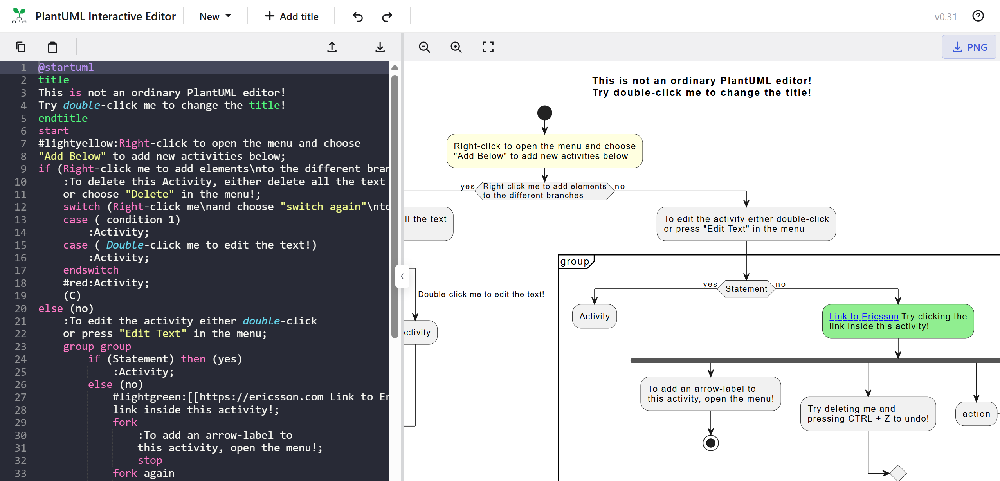

# PlantUML Interactive Editor

<table>
<tr>
<td>

Welcome to PlantUML Interactive Editor! This application is designed to provide an intuitive and interactive environment for editing PlantUML code and generating diagrams in real-time. Whether you're creating a huge activity diagram or a single while loop, our tool streamlines the process, allowing you to focus on design rather than syntax.

Interactive editing is supported for both **activity diagrams** and **sequence (signaling) diagrams**.

The editor is available in two forms:

- **Web application**: run the server locally and edit in the browser (see below)
- **VS Code extension**: edit PlantUML files interactively in a panel beside the code, with every change written back into the document. See the [extension README](./plantuml-extension/README.md) for installation and details

</td>
<td width="96">


</td>
</tr>
</table>



With PlantUML Interactive Editor, you can:

- Edit PlantUML activity and sequence diagrams by directly interacting with the diagram
- Also change the diagram by editing the PlantUML code, just like other PlantUML editors, allowing you to choose code or interactive editing depending on what is easier in the moment
- Instantly preview diagrams as you type
- Easily share the created diagram

## Usage

- Right-click on elements to open context menu
- Double-click on elements to edit the text
- Submit edited text with the button or using CTRL + ENTER
- Left-click and drag in the diagram to pan
- Use mouse wheel or pinch on touch pad to zoom
- Delete the text of a title, note or group/partition to delete the element
- To share a diagram, just copy the URL in the address bar
- Hover over elements to see the corresponding line highlighted in the editor
- Clicking on, or hovering over, a line in the editor highlights the corresponding element in the diagram — all element types in both activity and sequence diagrams
- Collapse the code editor pane by clicking the chevron on the pane divider (or dragging the divider past its minimum width) to give the diagram more space; expand it again the same way

## Detailed list of supported and unsupported features

[FEATURES.md](./FEATURES.md)

## Pre-requisites

- Python 3.10 or newer
- PlantUML, https://plantuml.com/starting
- The path to the PlantUML must be set in an .env file, see .env.example


## Installing and running the server

In the target python environment:

```
pip install .
python -m plantuml_gui
```

## Development

### Pre-requisites

- uv

### Setup

```
uv run pre-commit install -t pre-commit -t pre-push
```

### Running tests

#### Python

##### Without coverage

```
uv run pytest
```

##### With coverage

```
uv run python -m pytest --cov --cov-report=html
```

#### Javascript

```
uv run pytest tests/e2e/
```

### Versioning

Versions follow [semver](https://semver.org) (`X.Y.Z`). Every PR describes its change under `## [Unreleased]` in `CHANGELOG.md` but leaves the version alone. Releasing is a separate, deliberate step: review the unreleased entries, pick the step they call for, and run

```
uv run python scripts/bump_version.py patch   # bug fixes only
uv run python scripts/bump_version.py minor   # new features
uv run python scripts/bump_version.py major   # incompatible changes
```

This updates every version file and turns `[Unreleased]` into `[X.Y.Z] - <date>`. Do it in a release PR, or inside a small fix PR you want out quickly. Once that is merged, `scripts/build_release.sh <destination>` publishes it from a clean checkout and tags the commit `vX.Y.Z`; it refuses if that version was already released from another commit.
